<h1 align="center">🛡️ Hero's Shield Artwork HD</h1>

<p align="center"><b>Mod para Zelda 64: Recompiled (Majora's Mask) · A mod for Zelda 64: Recompiled (Majora's Mask)</b></p>

<p align="center"><a href="https://reset-hightide.github.io/heros-shield-artwork-hd/">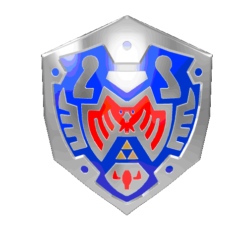</a></p>

<p align="center">
<a href="https://github.com/reset-hightide/heros-shield-artwork-hd/releases/latest"></a>
<a href="https://reset-hightide.github.io/heros-shield-artwork-hd/"></a>
</p>

<p align="center">Windows · Linux · Steam Deck · macOS</p>

**[🇧🇷 Português](#-português) · [🇺🇸 English](#-english)**

| N64 original | Hero's Shield Artwork HD |
|:-:|:-:|
| 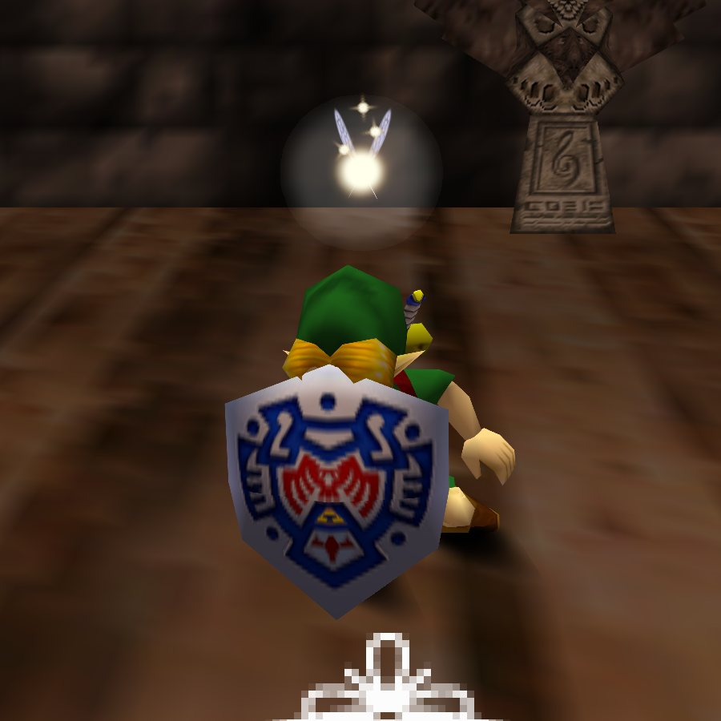 | 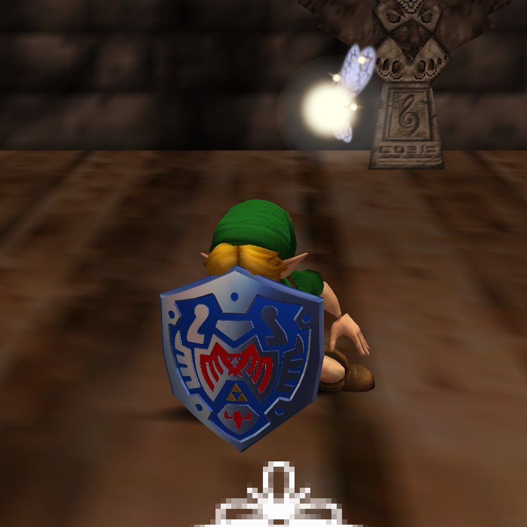 |
| 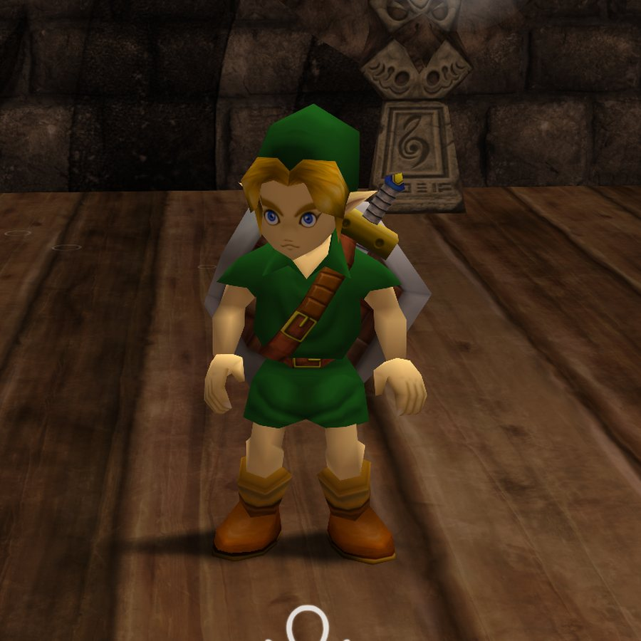 | 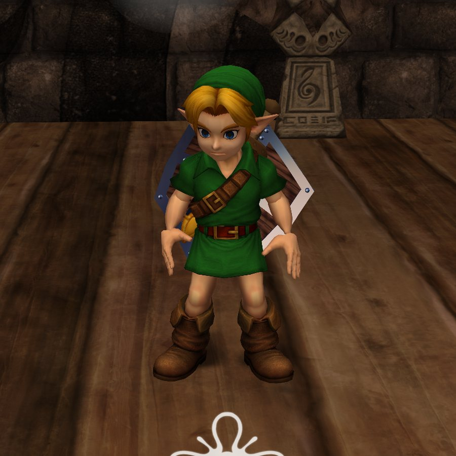 |
| 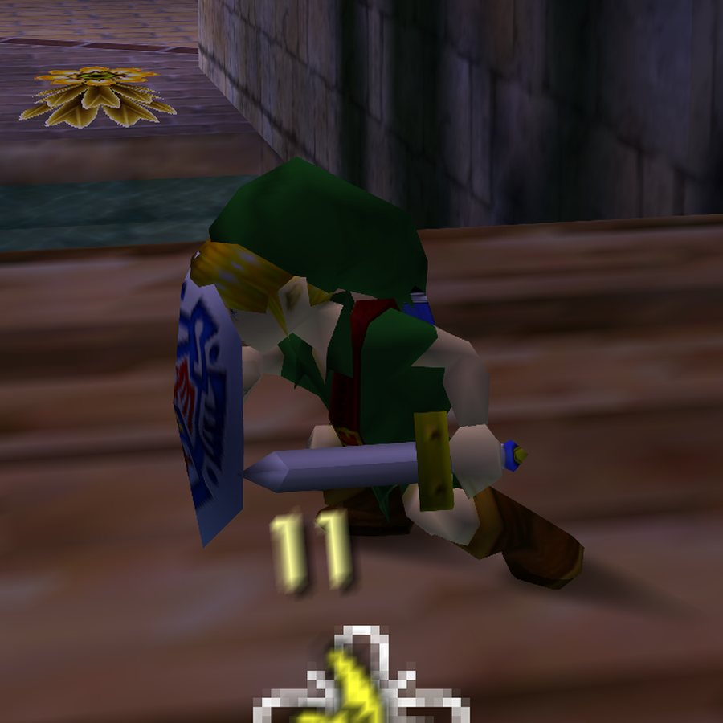 | 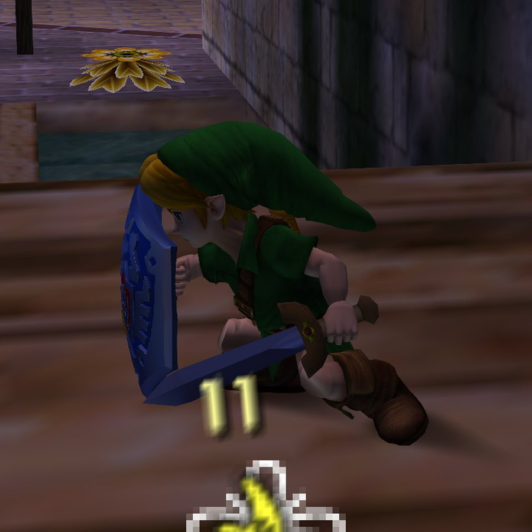 |

<p align="center"><i>Prints do jogo, mesma pose, com o cenário do MM-Reloaded · In-game, same pose, MM-Reloaded scenery · <a href="https://reset-hightide.github.io/heros-shield-artwork-hd/#compare">mais comparações / more comparisons</a></i></p>

---

## 🇧🇷 Português

No Majora's Mask o Link deixa Hyrule atrás de uma amiga e chega a Termina sem o Hylian Shield. Quem vai com ele é o Hero's Shield. Só que no N64 esse escudo sempre foi uma textura chapada numa placa de poucos polígonos.

O Hylian Shield já ganhou versões 3D lindas em outros mods, como o Art Plus do Skilar. O Hero's Shield, que eu saiba, nunca teve isso. Então eu refiz ele a partir da arte oficial: o desenho virou relevo, com prata polida, a Triforce em ouro e esmalte azul e vermelho. Atrás tem madeira, faixas de metal com rebites, uma alça de couro e uma empunhadura que o Link segura de verdade. Na faixa de metal está gravada a Song of Time, para ele nunca esquecer o caminho de volta ao Primeiro Dia.

<p align="center">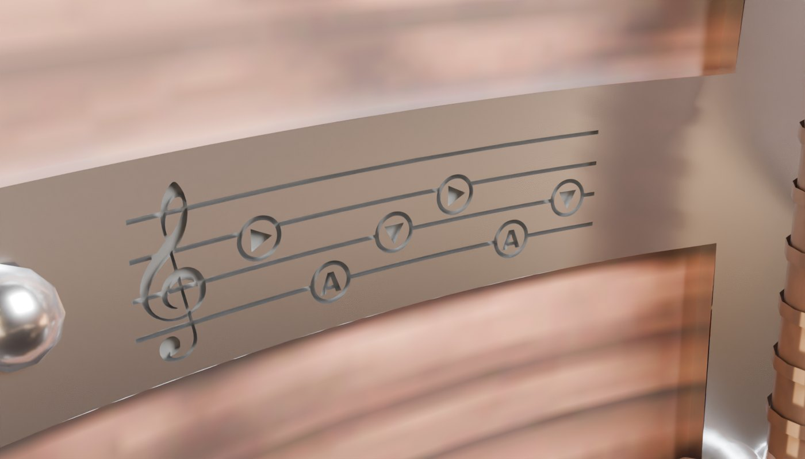</p>

### O que vem no pacote

| | | |
|:-:|---|---|
| **01** | 🛡️ **Hero's Shield Artwork HD** | O escudo novo, frente e costas. Os arquivos 3D (`.glb` e `.blend`) estão na pasta [`3d/`](3d). |
| **02** | 🧝 **HW Young Link HD** | O Young Link de Hyrule Warriors do mod do **PxExYxTxOxN** para o Ship of Harkinian, portado para o Recomp. Usa o esqueleto e as animações do próprio jogo. |
| **03** | ⚔️ **Equipamento do Art Plus** | Vem junto com o Link: a Kokiri Sword, cujo modelo também aparece na Razor Sword (a Razor equipada tem o mesmo visual da Kokiri), a bainha nas costas e a Ocarina of Time, com brilho de metal. Na defesa, a espada fica num ângulo que não atravessa o escudo. |
| **04** | 🩸 **Hero's Shield Aftermath** | O mesmo escudo, gasto: cortes de lâmina no esmalte, a Triforce rachada e as costas marcadas. Veja a história abaixo. |

Dá para usar só o escudo, só o Link ou tudo junto. A escolha é feita no menu do Player Model Manager, que abre com **L + A** no jogo.

### Hero's Shield Aftermath

<p align="center">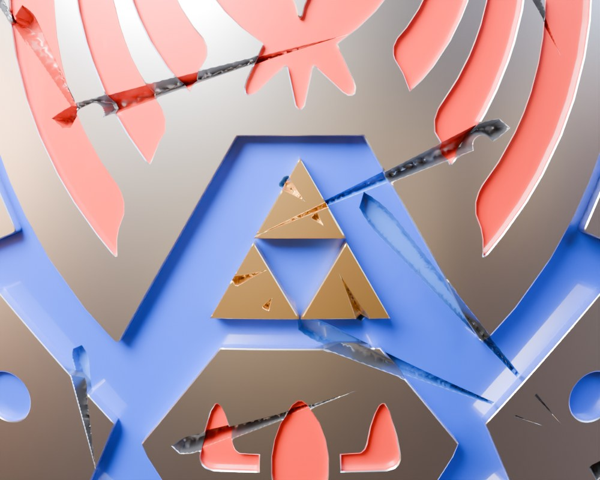</p>

Em Termina, todos esquecem. Quando a Song of Time é tocada, tudo retorna ao início.

Este é o Hero's Shield após incontáveis ciclos. Cada marca carrega a lembrança de um golpe que não pôde ser evitado, uma cicatriz que nem mesmo o tempo conseguiu apagar.

<p align="center">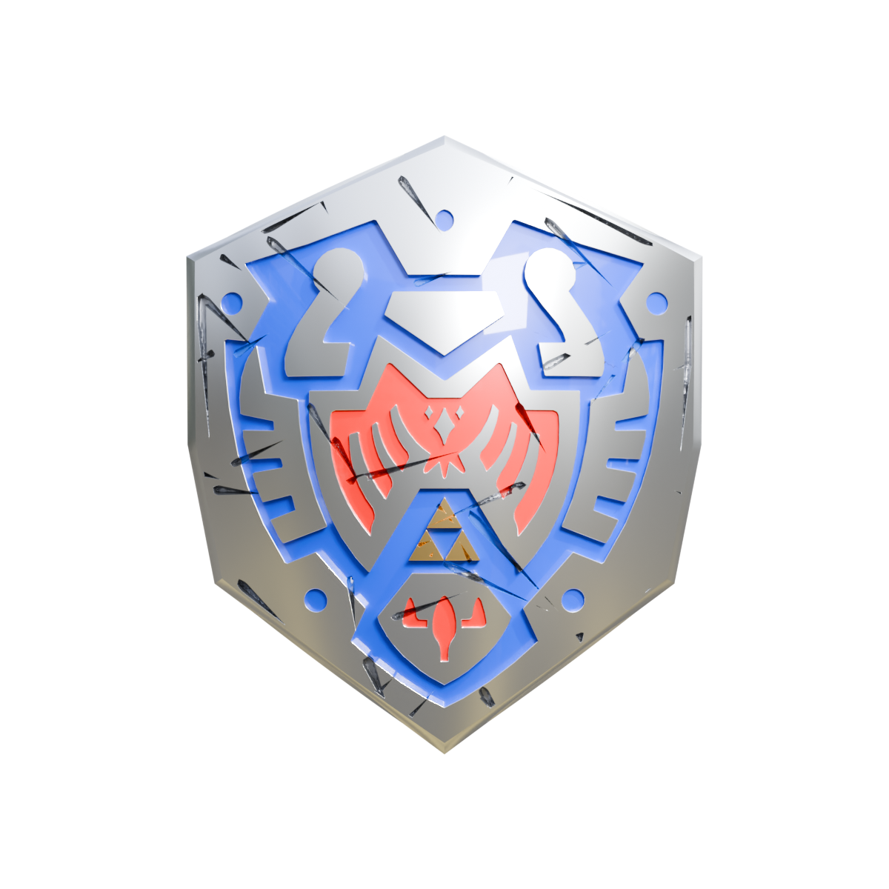 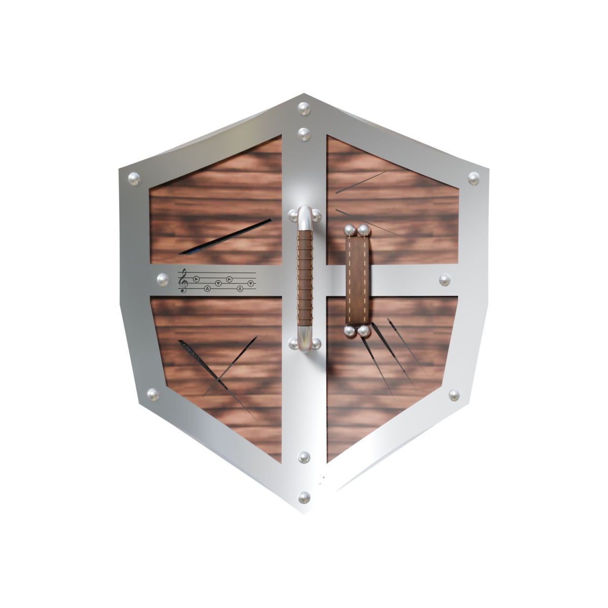</p>

É o mesmo desenho do Artwork HD, com cortes de lâmina no esmalte, a Triforce rachada e as costas marcadas. A Song of Time continua gravada. No menu **L + A**, em **Hero's Shield**, escolha **Hero's Shield Aftermath**.

### Instalar

Você precisa do [Zelda 64: Recompiled](https://github.com/Zelda64Recomp/Zelda64Recomp/releases/latest) **1.2.2 ou mais novo**, aberto pelo menos uma vez. Feche o jogo antes de instalar.

O instalador copia os mods, baixa o [Player Model Manager](https://thunderstore.io/c/zelda-64-recompiled/p/YAZMT/Player_Model_Manager/) e o que ele precisa, e, se você ainda não escolheu outros modelos, já deixa o Link e o escudo selecionados.

**🪟 Windows:** baixe o **`Heros-Shield-Artwork-HD.zip`** em [Releases](https://github.com/reset-hightide/heros-shield-artwork-hd/releases/latest), extraia e dê dois cliques em **`INSTALAR-Windows.bat`**. Se aparecer "O Windows protegeu o computador", clique em *Mais informações → Executar assim mesmo*. Ou cole no PowerShell:
```powershell
irm https://raw.githubusercontent.com/reset-hightide/heros-shield-artwork-hd/main/install.ps1 | iex
```

**🎮 Steam Deck / 🐧 Linux:** no Steam Deck, vá para o Modo Desktop e abra o Konsole. Cole e aperte Enter:
```sh
curl -fsSL https://raw.githubusercontent.com/reset-hightide/heros-shield-artwork-hd/main/install.sh | sh
```

**🍎 macOS:** o mesmo comando acima, no Terminal. Ou abra o `INSTALAR-Mac.command` do zip com botão direito → Abrir. Ainda não consegui testar num Mac de verdade; se der problema, me avise numa [issue](https://github.com/reset-hightide/heros-shield-artwork-hd/issues).

<details>
<summary><b>Instalação manual</b></summary>

1. Baixe na Thunderstore e instale estes mods, que o escudo e o Link precisam: [Player Model Manager](https://thunderstore.io/c/zelda-64-recompiled/p/YAZMT/Player_Model_Manager/), [Global Objects](https://thunderstore.io/c/zelda-64-recompiled/p/YAZMT/Global_Objects/), [YAZMT Core](https://thunderstore.io/c/zelda-64-recompiled/p/YAZMT/YAZMT_Core/) e [Recomp External Python](https://thunderstore.io/c/zelda-64-recompiled/p/LT_Schmiddy/RecompExternalPython_for_Zelda64Recompiled/). Os três últimos são o que o Player Model Manager pede.
2. Abra o jogo, vá em **Mods → Install Mods** e escolha os arquivos `.nrm` e `.rtz`, os desses mods e os da pasta [`mods/`](mods). Também dá para copiar todos para a pasta que abre em **Mods → Open Mods Folder**.
3. No jogo, aperte **L + A**. Em **Hero's Shield**, escolha **Hero's Shield Artwork HD** (ou **Hero's Shield Aftermath**). Em **Human**, escolha **HW Young Link HD (Art Plus gear)**.
</details>

**Dica:** com o [MM-Reloaded](https://github.com/GhostlyDark/MM-Reloaded) o resto do jogo também fica em HD. As comparações acima foram tiradas com ele.

---

## 🇺🇸 English

In Majora's Mask, Link leaves Hyrule looking for a friend and reaches Termina without the Hylian Shield. What he carries is the Hero's Shield. On the N64, though, that shield was always a flat texture on a low-poly board.

The Hylian Shield has already had beautiful 3D remakes in other mods, like Skilar's Art Plus. As far as I know, the Hero's Shield never did. So I rebuilt it from the official artwork: the design became real relief, with polished silver, a gold Triforce and blue and red enamel. The back has wood, riveted metal bands, a leather strap and a grip that Link actually holds. The Song of Time is engraved in the metal band, so he never forgets the way back to the First Day.

### What's in the pack

| | | |
|:-:|---|---|
| **01** | 🛡️ **Hero's Shield Artwork HD** | The new shield, front and back. The 3D files (`.glb` and `.blend`) are in the [`3d/`](3d) folder. |
| **02** | 🧝 **HW Young Link HD** | The Hyrule Warriors Young Link from **PxExYxTxOxN**'s Ship of Harkinian mod, ported to the Recomp. It uses the game's own skeleton and animations. |
| **03** | ⚔️ **Art Plus gear** | Comes with Link: the Kokiri Sword, whose model also shows up on the Razor Sword (an equipped Razor looks the same as the Kokiri), the sheath on his back and the Ocarina of Time, with a metal shine. When defending, the sword is angled so it doesn't go through the shield. |
| **04** | 🩸 **Hero's Shield Aftermath** | The same shield, worn down: blade cuts in the enamel, a cracked Triforce and a scarred back. See the story below. |

You can use just the shield, just Link, or everything. You pick them in the Player Model Manager menu, opened in game with **L + A**.

### Hero's Shield Aftermath

<p align="center"></p>

In Termina, everyone forgets. When the Song of Time is played, everything returns to the beginning.

This is the Hero's Shield after countless cycles. Each mark carries the memory of a blow that could not be avoided, a scar that not even time could erase.

<p align="center"> </p>

Same design as Artwork HD, with blade cuts in the enamel, a cracked Triforce and a scarred back. The Song of Time is still engraved. In the **L + A** menu, under **Hero's Shield**, pick **Hero's Shield Aftermath**.

### Install

You need [Zelda 64: Recompiled](https://github.com/Zelda64Recomp/Zelda64Recomp/releases/latest) **1.2.2 or newer**, started at least once. Close the game before installing.

The installer copies the mods, downloads [Player Model Manager](https://thunderstore.io/c/zelda-64-recompiled/p/YAZMT/Player_Model_Manager/) and what it needs, and, if you haven't picked other models yet, selects Link and the shield for you.

**🪟 Windows:** download **`Heros-Shield-Artwork-HD.zip`** from [Releases](https://github.com/reset-hightide/heros-shield-artwork-hd/releases/latest), extract it and double-click **`INSTALAR-Windows.bat`**. If SmartScreen shows up, click *More info → Run anyway*. Or paste this into PowerShell:
```powershell
irm https://raw.githubusercontent.com/reset-hightide/heros-shield-artwork-hd/main/install.ps1 | iex
```

**🎮 Steam Deck / 🐧 Linux:** on the Steam Deck, switch to Desktop Mode and open Konsole. Paste this and press Enter:
```sh
curl -fsSL https://raw.githubusercontent.com/reset-hightide/heros-shield-artwork-hd/main/install.sh | sh
```

**🍎 macOS:** the same command in Terminal, or right-click `INSTALAR-Mac.command` in the zip → Open. I haven't been able to test it on a real Mac yet, so if something goes wrong please tell me in an [issue](https://github.com/reset-hightide/heros-shield-artwork-hd/issues).

<details>
<summary><b>Manual install</b></summary>

1. Download these mods from Thunderstore, the shield and Link need them: [Player Model Manager](https://thunderstore.io/c/zelda-64-recompiled/p/YAZMT/Player_Model_Manager/), [Global Objects](https://thunderstore.io/c/zelda-64-recompiled/p/YAZMT/Global_Objects/), [YAZMT Core](https://thunderstore.io/c/zelda-64-recompiled/p/YAZMT/YAZMT_Core/) and [Recomp External Python](https://thunderstore.io/c/zelda-64-recompiled/p/LT_Schmiddy/RecompExternalPython_for_Zelda64Recompiled/). The last three are what Player Model Manager requires.
2. Start the game, go to **Mods → Install Mods** and pick the `.nrm` and `.rtz` files, both from those mods and from the [`mods/`](mods) folder. You can also copy them all into the folder that **Mods → Open Mods Folder** opens.
3. In game, press **L + A**. Under **Hero's Shield**, pick **Hero's Shield Artwork HD** (or **Hero's Shield Aftermath**). Under **Human**, pick **HW Young Link HD (Art Plus gear)**.
</details>

**Tip:** with [MM-Reloaded](https://github.com/GhostlyDark/MM-Reloaded) the rest of the game is in HD too. The comparisons above were taken with it.

---

## Créditos / Credits

**Nosso trabalho / Our work: [Bruno Gebara (reset-hightide)](https://github.com/reset-hightide)**
- Hero's Shield Artwork HD e Hero's Shield Aftermath / and Hero's Shield Aftermath.
- A adaptação do Link e dos equipamentos para o Majora's Mask: esqueleto e animações do jogo, espada na mão, inclinação da espada na defesa, bainha, escudo na mão, mão aberta ajustada, texturas HD no Recomp. / The port of Link and the gear to Majora's Mask: the game's skeleton and animations, sword in hand, sword angle when defending, sheath, shield in hand, adjusted open hand, HD textures in the Recomp.
- Os instaladores. / The installers.

**Modelos de outros autores / Models by others**
- Young Link de Hyrule Warriors (Koei Tecmo / Nintendo), convertido para o Ocarina of Time no Ship of Harkinian por **PxExYxTxOxN**: [Hyrule Warriors Link](https://gamebanana.com/mods/491210). / Hyrule Warriors Young Link (Koei Tecmo / Nintendo), converted to Ocarina of Time in Ship of Harkinian by **PxExYxTxOxN**.
- Espada, bainha e ocarina: Art Plus do **Skilar**, de onde saem o metal reflexivo e a madeira. / Sword, sheath and ocarina: **Skilar**'s Art Plus, source of the reflective metal and the wood.
- Player Model Manager, Global Objects e YAZMT Core: **YAZMT**. Recomp External Python: **LT_Schmiddy**. Zelda 64: Recompiled: equipe Zelda64Recomp. / Player Model Manager, Global Objects and YAZMT Core by **YAZMT**; Recomp External Python by **LT_Schmiddy**; Zelda 64: Recompiled by the Zelda64Recomp team.
- Ideia de gravar a Song of Time: [@arsenaldehyrule](https://www.instagram.com/arsenaldehyrule/). / Song of Time engraving idea: @arsenaldehyrule.

Projeto de fã, sem relação com a Nintendo ou a Koei Tecmo. Nenhuma ROM ou dado do jogo está incluído. / Fan project, not affiliated with Nintendo or Koei Tecmo. No ROM or game data is included.
